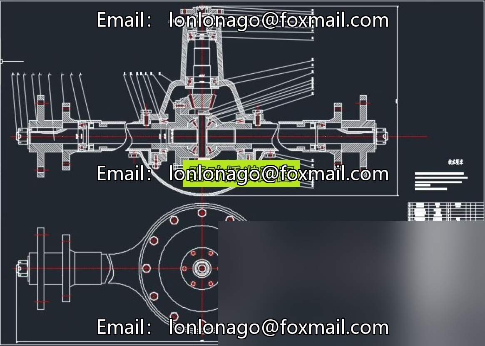
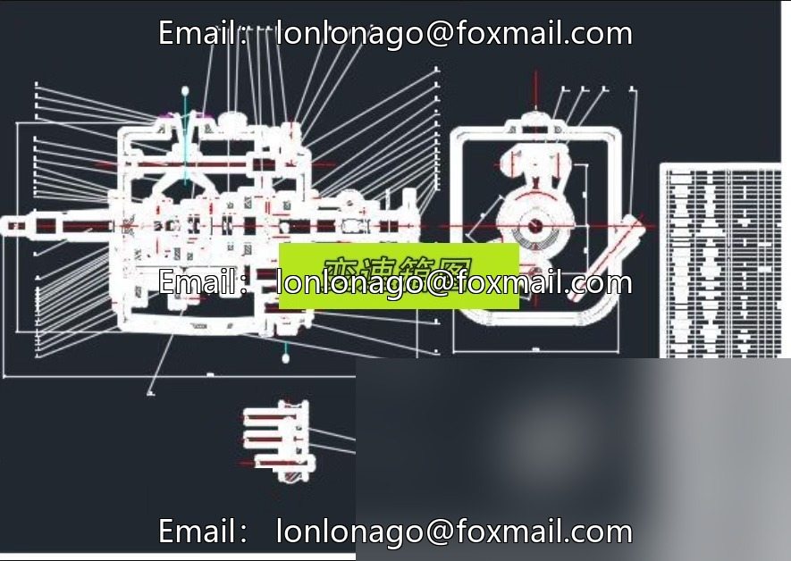
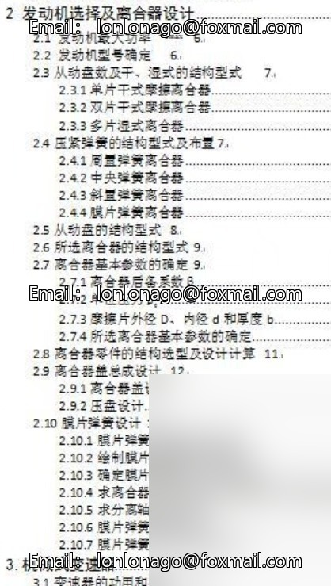

# Car transmission system design; car transmission system design diagram; car transmission system design CAD.

## Body

Automobile transmission system design; automobile transmission system design diagram; automobile transmission system design CAD diagram; automobile transmission system diagram

The drawings cover automotive transmission design, CAD implementations, assembly diagrams, and design calculations for clutch structures and mechanical transmissions.

<!-- AI_ENRICHED -->

## Images

## Payment

Here is a pay link on Stripe ( https://buy.stripe.com/3cs8yP7sY87d0vu9AB ). Please contact me lonlonago@foxmail.com after funding $89, and I will send you a complete data files , thank you!

